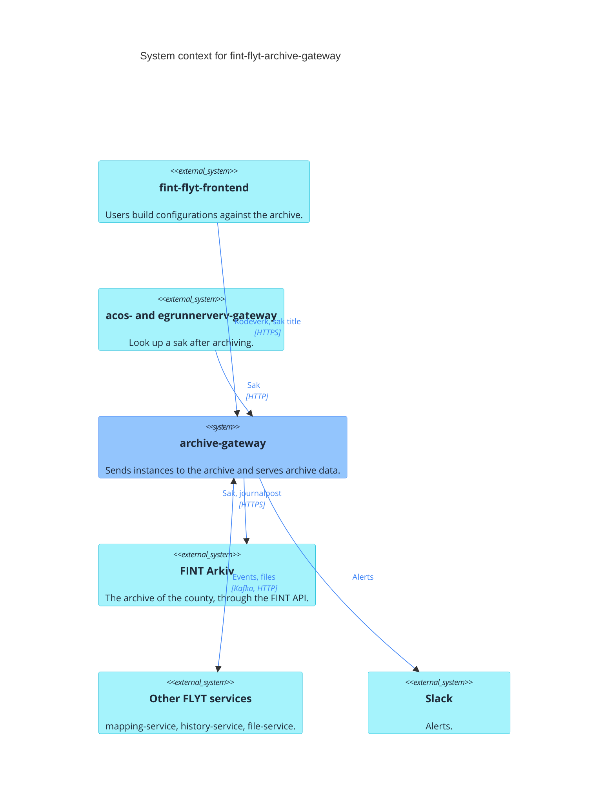
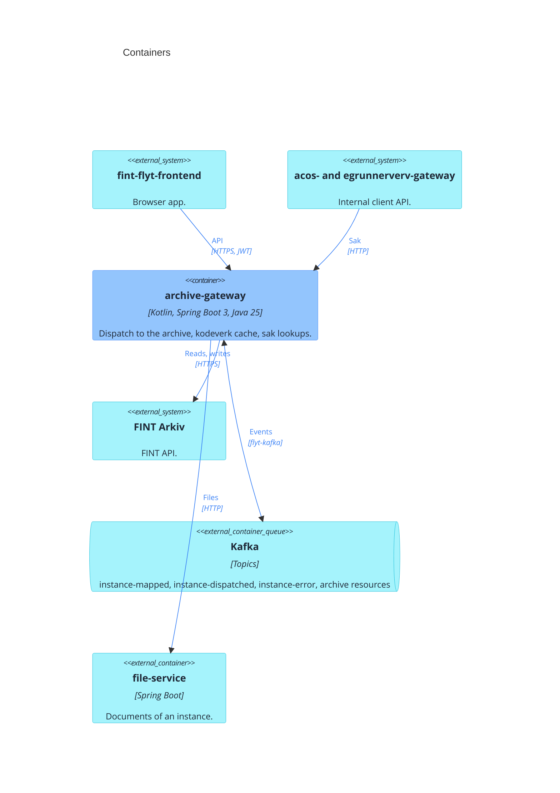
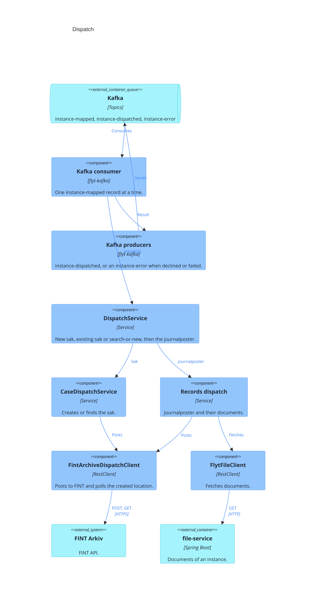
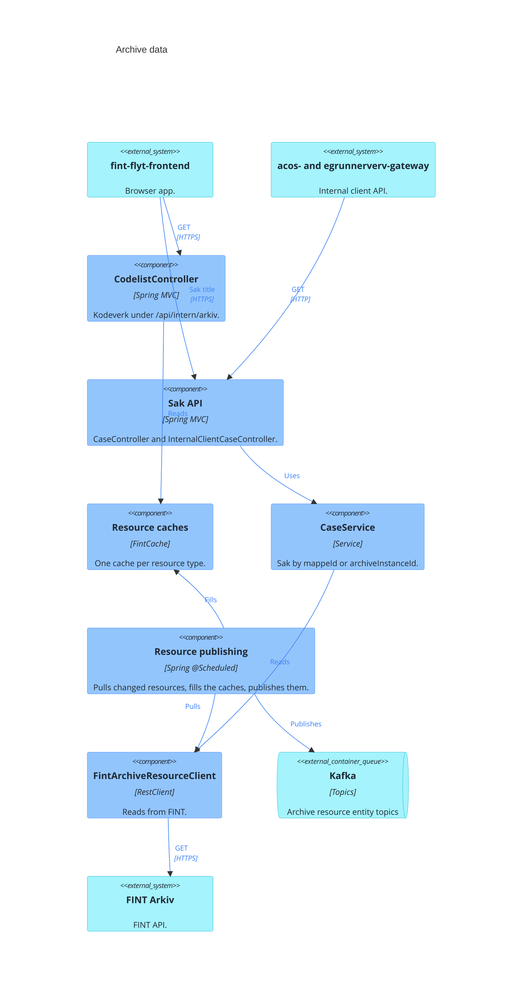

# Architecture

C4 level 1 to 3 for fint-flyt-archive-gateway. Blue is this service, turquoise is external.

## C4 level 1: System context

Archive-gateway is the last step in the FLYT flow. It sends a mapped instance to the archive as a
sak with journalposter and documents, and serves archive data to the frontend and the gateways.

- **Other FLYT services:** mapping-service publishes `instance-mapped`. Archive-gateway publishes
  `instance-dispatched` or an `instance-error`, which history-service stores. Documents are fetched
  from file-service.
- **acos-gateway and egrunnerverv-gateway** look up the sak of an archived instance over
  `/api/intern-klient/arkiv/saker`, with a token for `fint-flyt-authorization-oauth2-client`, the
  shared client for internal calls. This replaced the `arkiv-noark-sak` request/reply topics
  (FFS-2391, removed in FFS-2400).
- **FINT Arkiv** is called with the FINT client of the org. Tokens come from NAM (not shown).
- **Slack** gets an alert when a dispatch call to the archive fails.

## C4 level 2: Containers

One Spring Boot application with no database. Archive resources are cached in memory.

- The ingress only routes `/api/intern/arkiv`. The internal client API, Swagger UI, OpenAPI and
  Actuator are only reachable inside the cluster.
- The archive resources (kodeverk, arkivressurser and more) are also published on entity topics.

## C4 level 3: Components

### Dispatch

- `InstanceMappedEventConsumerConfiguration` hands each record to `DispatchService` and publishes
  the result with `InstanceDispatchedEventProducerService` or `InstanceErrorEventProducerService`.
  Failed records are skipped without retry.
- Records dispatch is `RecordsProcessingService`, `RecordsDispatchService`, `RecordDispatchService`
  and `FilesDispatchService`.
- `FintArchiveDispatchClient` posts to FINT, which answers `202 Accepted` with a location. The
  client polls the location until the sak or journalpost is created, or until the timeout.

### Archive data

- `FintResourcePublishingConfiguration` pulls changed resources on a fixed delay and clears the
  "last updated" timestamps once a day, so the next pull fetches everything again.
- `CaseController` returns the title of a sak to the frontend. `InternalClientCaseController`
  returns the whole sak to the gateways, or a sak with only the journalposter in an
  `archiveInstanceId` such as `2024/123-[1,2]`. See [Internal client API](../README.md#internal-client-api).
- `ArchiveTemplateController` returns the mapping template the frontend builds archive
  configurations from. It is static and does not call FINT.
